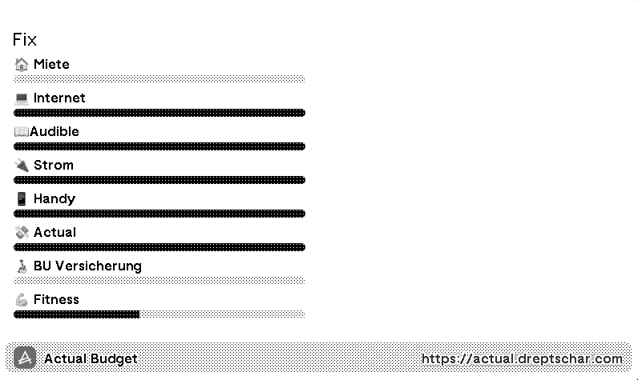

# trmnl-actual-plugin-server

Backend server for a **TRMNL** plugin that shows selected category balances from [Actual Budget](https://actualbudget.org).



## What it does

The server exposes one endpoint:

- `POST /api/markup`

It receives credentials and budget parameters, loads data via `@actual-app/api`, filters the categories for the selected group, and returns a JSON payload for the TRMNL client.

## Runtime Architecture

- Go HTTP server: [`main.go`](main.go)
- Go talks to a pool of long-lived Node workers: [`worker.js`](worker.js)
- Node uses Actual API wrapper: [`actual.js`](actual.js)

Current startup command:

```bash
npm start
```

This runs:

```bash
go run main.go
```

On startup, Go spawns a small pool of `node worker.js` processes and keeps them running. Each incoming request is handed to one free worker over its stdin/stdout as a single JSON line in, single JSON line out — no new process is spawned per request anymore, which removes Node's module-load/startup cost from the hot path. A worker that errors or times out is killed and replaced rather than reused.

None of this changes what's retained between requests: every job still downloads and decrypts the requested budget into its own temp directory under `./tmp/cache`, computes the response, then deletes that directory before the worker goes back in the pool — no tenant data is persisted between jobs, and nothing is cached or reused across tenants. In Docker, that cache directory is additionally mounted as `tmpfs` (RAM-backed), so it never touches disk at all (see [`docker-compose.yml`](docker-compose.yml)).

### Configuration

Environment variables (both optional):

- `MAX_CONCURRENT_JOBS` — size of the Node worker pool, i.e. the max number of budget fetches that run at once. Extra requests queue (bounded by `REQUEST_TIMEOUT_SECONDS`) instead of spawning unbounded concurrent downloads. Defaults to `min(NumCPU, 4)` — each worker is a resident process holding `@actual-app/api` in memory, so this is intentionally conservative; raise it explicitly if your deployment needs more throughput.
- `REQUEST_TIMEOUT_SECONDS` — max seconds a request may spend queued plus fetching before it fails. Defaults to `45`.

## API Contract

### Endpoint

`POST /api/markup`

### Request body

```json
{
  "serverURL": "https://actual.example.com",
  "serverPassword": "your-actual-server-password",
  "budgetSyncId": "00000000-0000-0000-0000-000000000000",
  "budgetEncryptionPassword": "optional-budget-password",
  "groupName": "Flexi",
  "included": "Category A,Category B"
}
```

### Validation

The API validates:

- `serverURL` is required and must be a valid `http/https` URL
- `serverPassword` is required
- `budgetSyncId` is required and must be a valid UUID
- `groupName` is required

### Response behavior

Important: the endpoint always responds with HTTP `200`.

- Success: JSON array of matching category balances
- Failure: JSON object with an `error` field

Example success response:

```json
[
  {
    "name": "Groceries",
    "budgeted": 275.61,
    "spent": -213.62,
    "balance": 81.89
  }
]
```

Example error response:

```json
{
  "error": "invalid request payload: serverURL is required"
}
```

## Local Development

Install dependencies:

```bash
npm install
```

Run server:

```bash
npm start
```

Default address:

- `http://localhost:8080`

## Docker

Build and run with Docker Compose:

```bash
docker compose up --build
```

Or use the published image:

- `dreptschar/trmnl-actual-plugin-server:latest`
